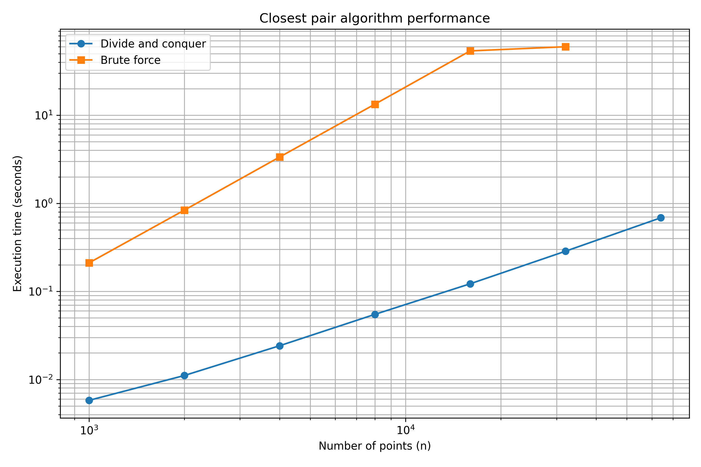

# Assignment 2: Closest Camera Traps

**Student number ending:** 372  
**AI tool statement:** I used OpenAI Codex to review the draft, fix the benchmark output, and help check the implementation against the assignment requirements. I ran the tests and compared the two algorithms on the same inputs.

## Part C: Analysis

The divide-and-conquer method sorts the points by x and y, then divides them into two halves. Each half is solved recursively. At each level, the points are divided into the left and right y-sorted lists and the strip near the dividing line is checked. These steps take linear time in total at that level. The strip check only needs to compare each point with a fixed number of following points.

The recurrence is:

```text
T(n) = 2T(n/2) + Θ(n), with T(n) = Θ(1) for n ≤ 3.
```

By the Master Method, `a = 2`, `b = 2`, and `f(n) = Θ(n)`. Since `n^(log_b a) = n`, this is the equal-growth case, so `T(n) = Θ(n log n)`. The brute-force method checks every pair and takes `Θ(n²)` time.

### Timing results

The following measurements were collected on this computer using the same seeded random points for each method. Brute force was stopped at 60 seconds; `>60 s (stopped)` means the full calculation did not finish within that limit.

| Points | Divide and conquer (s) | Brute force (s) |
|---:|---:|---:|
| 1,000 | 0.006 | 0.211 |
| 2,000 | 0.011 | 0.835 |
| 4,000 | 0.024 | 3.352 |
| 8,000 | 0.055 | 13.345 |
| 16,000 | 0.122 | 53.802 |
| 32,000 | 0.286 | >60 (stopped) |
| 64,000 | 0.685 | skipped after timeout |

The first measured size where divide and conquer was faster was `n = 1,000`, the smallest size in the required benchmark list. The true crossover may be below 1,000; smaller sizes were not included in this benchmark.



The measured divide-and-conquer times grow much more slowly than the brute-force times. Small timing differences can come from interpreter overhead, the computer's workload, and the random point distribution. At 32,000 points, the brute-force function checked the time limit during the run and stopped at approximately 60 seconds.

## Part D: Critical reflection

The measured results broadly matched the recurrence. The divide-and-conquer times rose from about 0.006 seconds at 1,000 points to 0.685 seconds at 64,000 points. The brute-force time rose from 0.211 seconds at 1,000 points to 53.802 seconds at 16,000 points, which reflects the much faster growth expected from checking every pair. Actual timings are not exact mathematical curves because the computer and Python interpreter add overhead.

Brute force was already slower at the smallest tested input, 1,000 points. For very small inputs it can still be faster because it has little setup: it simply checks pairs. The divide-and-conquer method sorts points and creates recursive sublists, which adds overhead even though its asymptotic growth is better.

The dividing-line case needed careful checking because the closest two points can lie in opposite halves. I compared the divide-and-conquer result with brute force and included a specific test where the closest pair crosses the split. The 500 seeded random cases gave another check that both methods return the same distance and original indices.

Codex helped identify errors in the benchmark output and helped prepare the analysis. I checked the result by running the sample, all six test groups, and the performance benchmark. Both methods returned the expected sample pair, and the tests passed.
