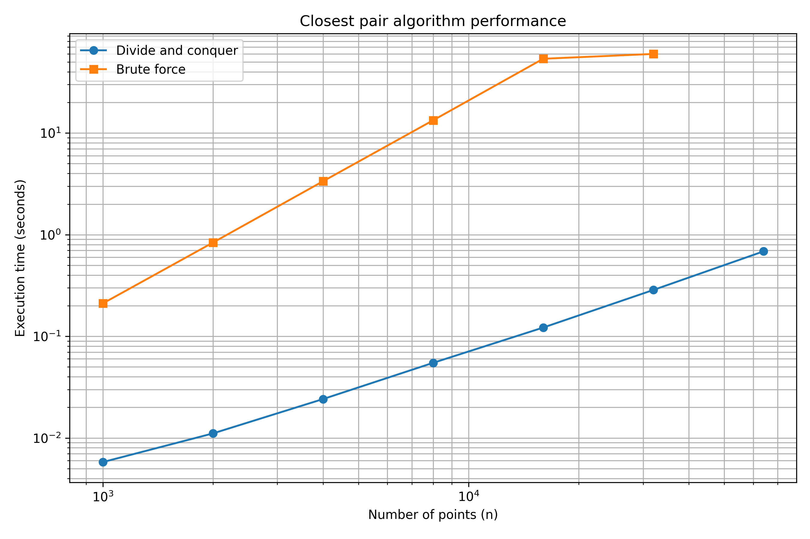

# Assignment 2: Program Output

This page records the main terminal output and includes the performance graph generated by the benchmark. The separate analysis and reflection are in `Assignment2_Analysis_And_Reflection.md`.

## Question 1: Closest pair

Running `Assignment2_Q1_ClosestPair.py` prints the result from both implementations:

```text
Brute Force Result:
(1.4142135623730951, 0, 5)

Divide and Conquer Result:
(1.4142135623730951, 0, 5)
```

Both methods find the points at indices 0 and 5, with distance √2.

## Question 1: Tests

`Assignment2_Q1_Tests.py` checks two points, duplicate points, a vertical line, a closest pair across the split, 500 random inputs, and invalid input. All six test groups pass.

## Question 2: Performance comparison

The benchmark uses the same generated points for both methods and stops brute force at 60 seconds. The graph below is generated from `Q2_Timing_Results.csv`.



At 32,000 points the brute-force calculation reached its 60-second limit and stopped. Its bar in the CSV records the timeout duration, not a completed result; brute force is skipped at 64,000 points.
