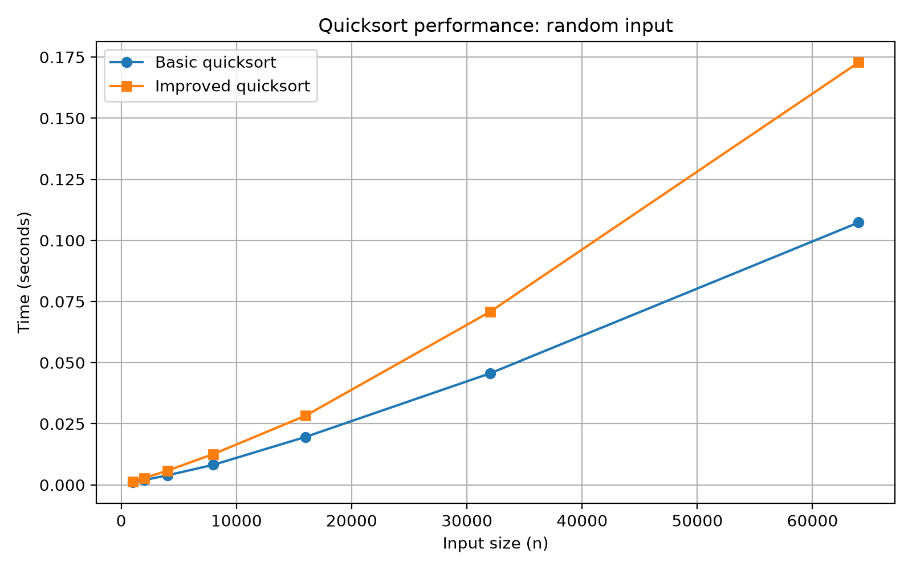
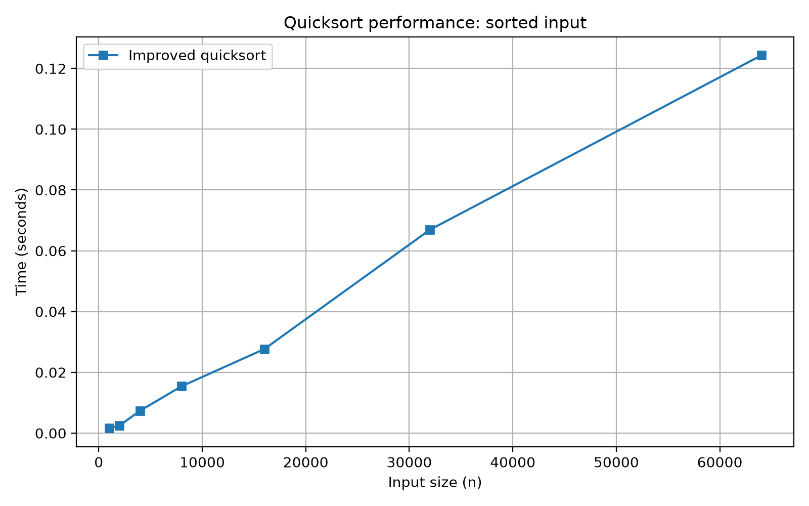
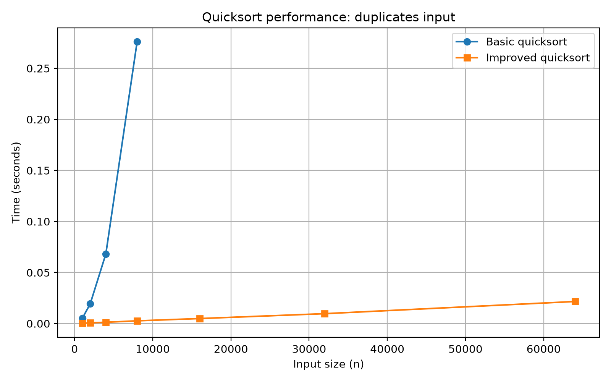

# Assignment 3: Fixing a Slow Quicksort

**Student number ending:** 372  
**AI tool statement:** I used OpenAI Codex to review my existing Lab 5 quicksort work, implement the assignment's improved version, and help prepare the benchmarks and explanation. I checked the algorithms against `sorted()` and ran the required tests and benchmarks.

## Part C: Analysis

### Input pattern timings

Times are in seconds. `RecursionError` means the basic last-element-pivot quicksort reached Python's recursion limit before finishing. The improved algorithm completed every input size.

| n | Random: basic | Random: improved | Sorted: basic | Sorted: improved | Duplicates: basic | Duplicates: improved |
|---:|---:|---:|---:|---:|---:|---:|
| 1,000 | 0.00106 | 0.00118 | RecursionError | 0.00119 | 0.00450 | 0.00034 |
| 2,000 | 0.00171 | 0.00270 | RecursionError | 0.00256 | 0.01655 | 0.00057 |
| 4,000 | 0.00372 | 0.00554 | RecursionError | 0.00538 | 0.06682 | 0.00121 |
| 8,000 | 0.00806 | 0.01289 | RecursionError | 0.01231 | 0.25019 | 0.00303 |
| 16,000 | 0.01908 | 0.02558 | RecursionError | 0.02774 | RecursionError | 0.00423 |
| 32,000 | 0.03817 | 0.05951 | RecursionError | 0.05646 | RecursionError | 0.01098 |
| 64,000 | 0.08249 | 0.13246 | RecursionError | 0.12775 | RecursionError | 0.01701 |







The basic sort was quicker on the random inputs in this run because it does less work per partition. The improved version was much quicker on duplicate-heavy inputs because its three-way partition puts equal values together instead of repeatedly partitioning them. On sorted input the basic version failed at every tested size, while the improved one completed.

### Why the basic version is slow

Lomuto partition chooses the final element as pivot. When the input is already sorted, that pivot is the largest value, leaving one side with `n - 1` items and the other empty. The recurrence is:

```text
T(n) = T(n - 1) + Θ(n)
```

Expanding it gives `Θ(n) + Θ(n - 1) + ... + Θ(1) = Θ(n²)`. The recursive calls also become a chain of length Θ(n), which exceeds Python's recursion limit. The average-case analysis assumes pivots tend to split the data reasonably well; sorted real data breaks that assumption for a fixed final-element pivot. With repeated values, the `<= pivot` rule also tends to place equal items on the same side, causing similarly unbalanced splits.

The improved version selects a random pivot, groups values into less-than, equal-to, and greater-than sections, uses insertion sort for short ranges, and recurses into the smaller side while iterating over the larger one. The smaller-side rule keeps recursion depth logarithmic. Three-way partitioning is especially helpful for the repeated Nu 100/Nu 500 style values.

### Cutoff and Python comparison

On 100,000 seeded random values, the cutoff timings were:

| Cutoff | Time (seconds) |
|---:|---:|
| 1 | 0.28884 |
| 4 | 0.28920 |
| 8 | **0.24010** |
| 16 | 0.28437 |
| 32 | 0.26035 |
| 64 | 0.24815 |

The best measured cutoff was 8, so I used it for the final comparison. Improved quicksort took 0.24149 seconds on 100,000 values, while Python's `sorted()` took 0.01330 seconds, about 18 times faster in this run. The built-in benefits from a highly tuned implementation and runs much of its work in optimized native code. Algorithm choices and implementation language both contribute to the difference; this timing alone cannot isolate each contribution.

## Part D: Critical reflection

The basic quicksort failed on sorted data because its final-element pivot repeatedly chose the maximum, producing an empty left partition and a right partition of size `n - 1`. The usual average-case analysis assumes more balanced splits. That assumption did not hold for this input pattern. The recursion chain also grew linearly until Python raised `RecursionError`.

Insertion sort is quadratic on a large range, but the improved algorithm uses it only on short ranges. For these small pieces, insertion sort has little setup work and moves nearby values efficiently. The benchmark found cutoff 8 fastest among the six tested options in the Python 3.14 run, though the best cutoff can vary by computer, Python version, and input.

Python's `sorted()` was about 18 times faster than my best quicksort measurement. The comparison reflects both algorithm engineering and implementation language: Python's built-in sort is heavily optimized, including native implementation work. I cannot separate those effects with this experiment alone.

Codex helped adapt the existing quicksort work and organize the benchmark. I checked the result against `sorted()` on 500 seeded random lists and the required edge cases, then benchmarked random, sorted, and duplicate-heavy data. All eight test groups passed