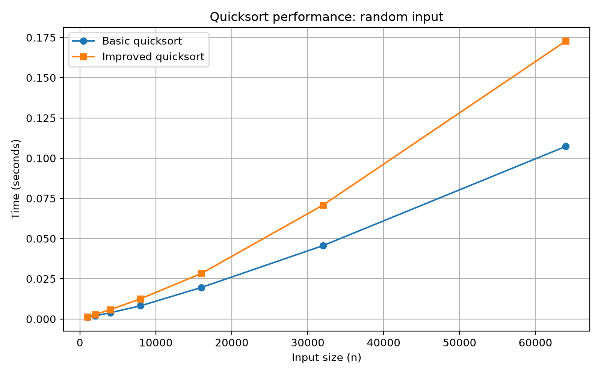
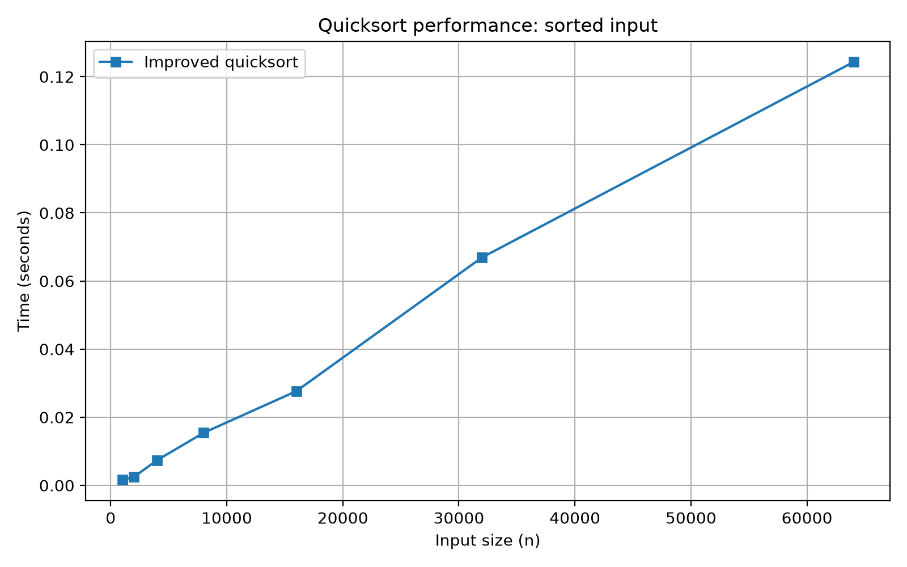
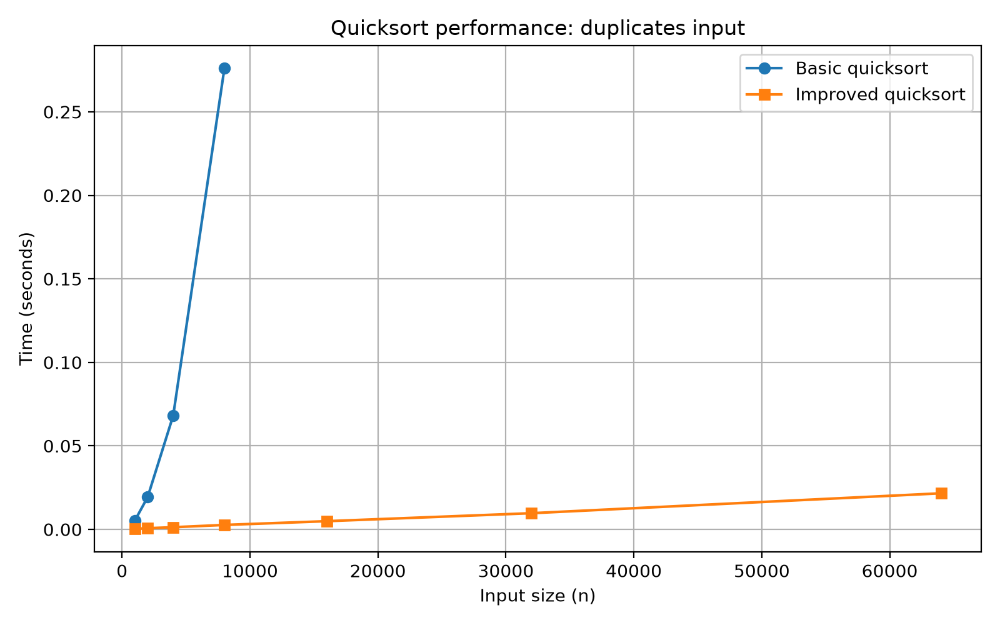

# Assignment 3: Output and Screenshots

This page collects the example output, test result, and benchmark graphs. The timing tables and analysis are in `Assignment3_Analysis_And_Reflection.md`.

## Question 1: Example output

Run `Assignment3_Q1_Sorts_372.py` to see both in-place sorts on the same sample:

```text
Basic quicksort: [-1, 3, 3, 5, 8]
Improved quicksort: [-1, 3, 3, 5, 8]
```

## Question 1: Tests

`Assignment3_Q1_Tests_372.py` checks an empty list, one value, equal values, sorted and reverse-sorted inputs, negative numbers, and 500 random lists. All eight test groups passed.

## Question 2: Performance graphs

The benchmark compares both versions on random, already sorted, and duplicate-heavy inputs from 1,000 to 64,000 items. A missing basic-quicksort point means it raised `RecursionError` before completing that input.







The CSV timing data and cutoff/Python comparison are saved in the `outputs` folder.
