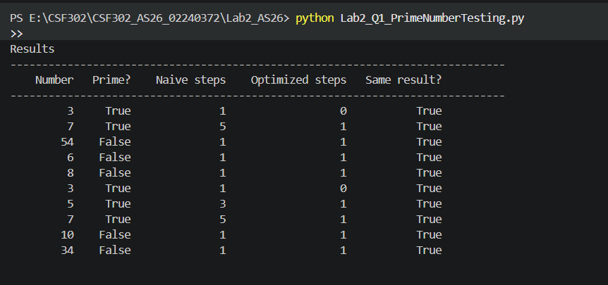
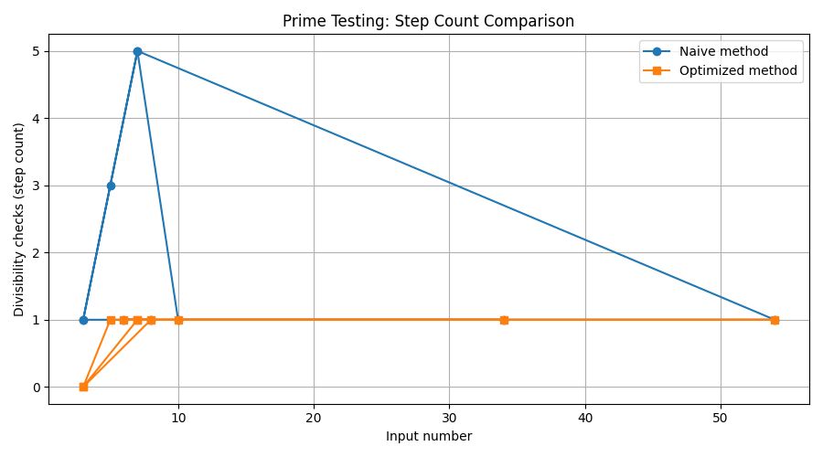
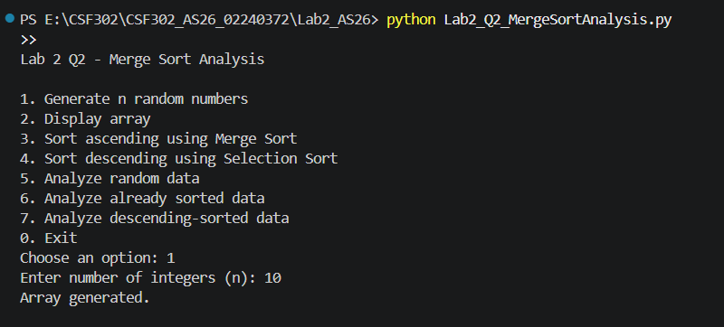
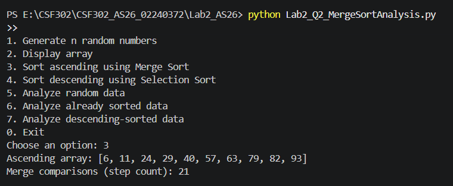
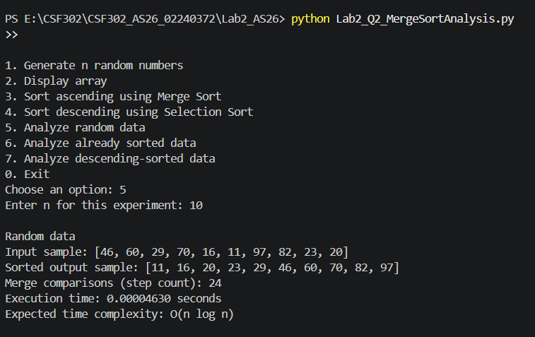
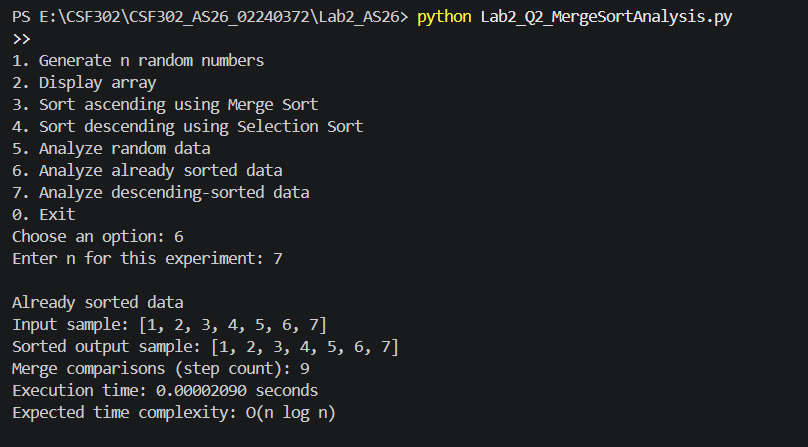
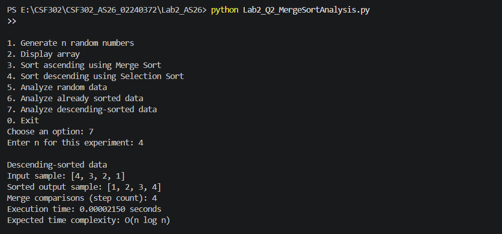
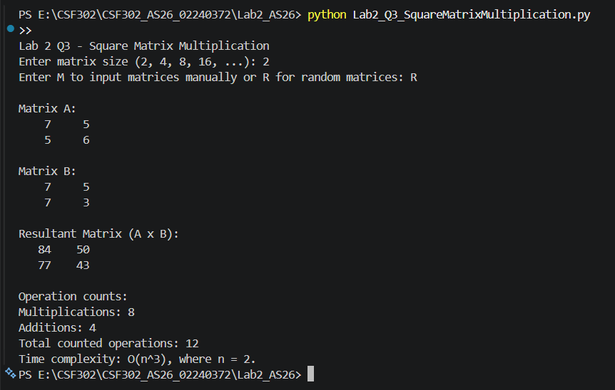

# Lab 2 Output Screenshots

## Q1: Prime Number Testing

**Screenshot 1 — Results for at least 10 numbers**

**Screenshot 2 — Step-count comparison graph**

## Q2: Merge Sort Analysis

**Screenshot 1 — Menu and generated array**

**Screenshot 2 — Ascending and descending sorting results**

**Screenshot 3 — Time/step-count experiment for random data**

**Screenshot 4 — Experiment for already sorted data**

**Screenshot 5 — Experiment for descending-sorted data**

## Q3: Square Matrix Multiplication

**Screenshot 1 — Input matrices and resultant matrix & Multiplication/addition operation counts**

