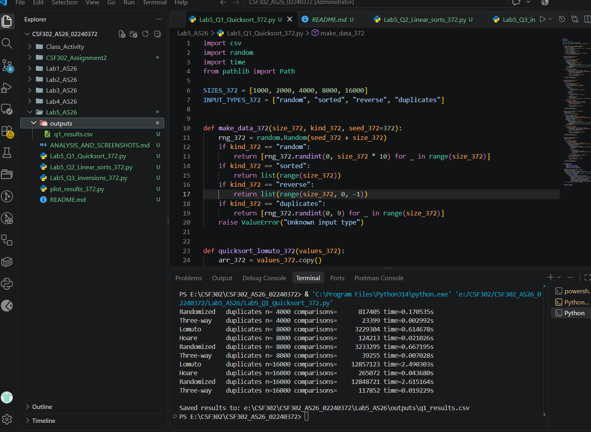
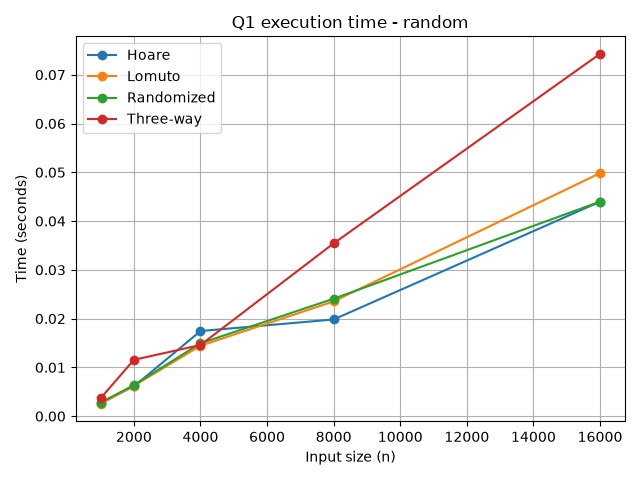
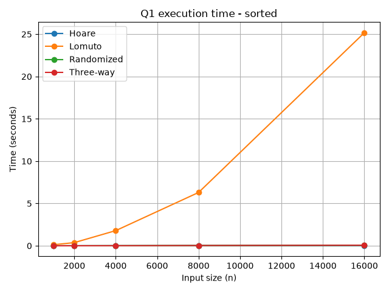
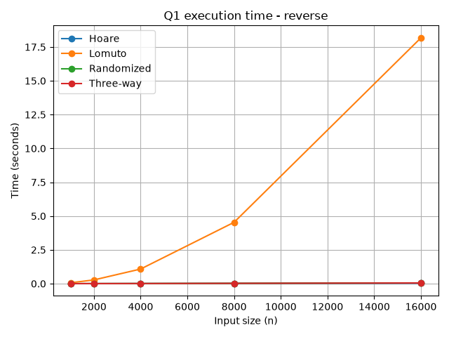
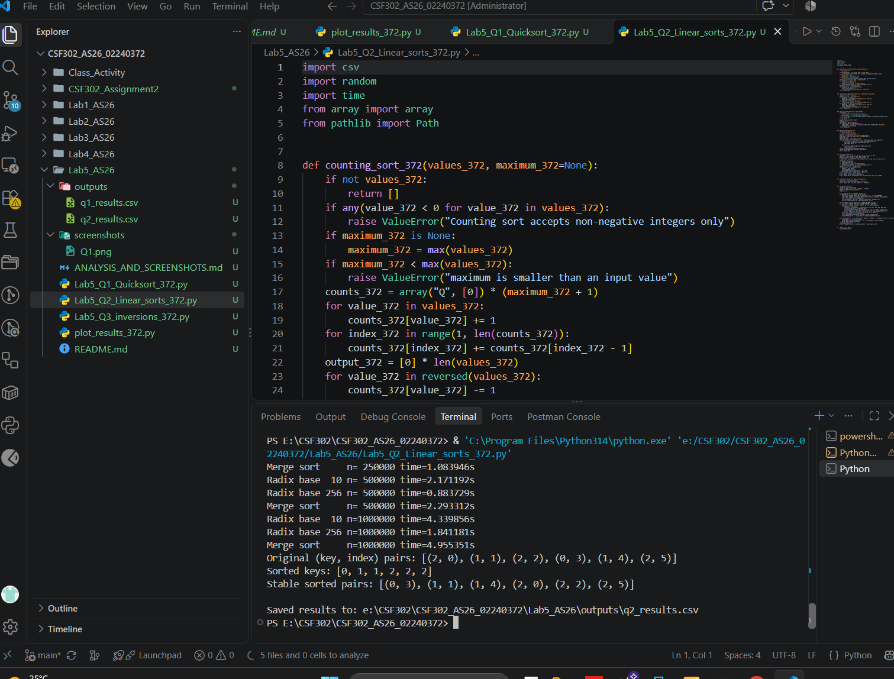
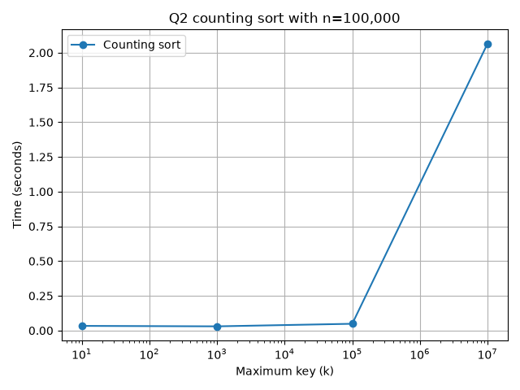
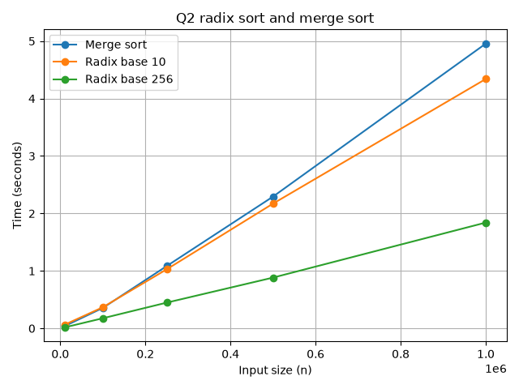
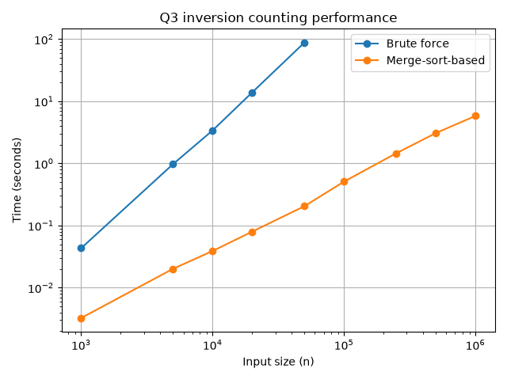
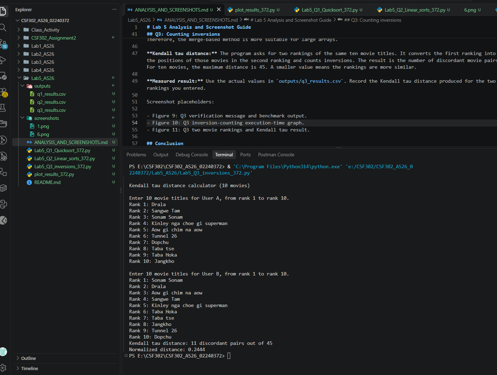

# Lab 5 Analysis and Screenshot Guide

## Q1: Quicksort variants

**What was tested:** Four quicksort implementations were tested using random, already sorted, reverse-sorted, and duplicate-heavy inputs. The sizes were 1,000, 2,000, 4,000, 8,000, and 16,000. The program records comparison counts and execution time in `outputs/q1_results.csv`.

**Analysis:** Lomuto partition with the last element as pivot can become unbalanced on already sorted and reverse-sorted input. This causes Θ(n²) time because one partition can contain almost all the elements. Randomized quicksort reduces the chance of repeatedly selecting a poor pivot. Hoare partition generally makes more balanced partitions with the middle element used as the pivot in this implementation. Three-way quicksort groups values smaller than, equal to, and greater than the pivot, so it is especially useful when many duplicate values occur.

Screenshots:

- Figure 1: Q1 terminal output showing comparison counts and execution times.

- Figure 2: Q1 execution-time graph for random input.

- Figure 3: Q1 execution-time graph for sorted input.

- Figure 4: Q1 execution-time graph for reverse-sorted input.

- Figure 5: Q1 execution-time graph for duplicate-heavy input.

## Q2: Counting sort and radix sort

**What was tested:** Counting sort uses n = 100,000 while k changes through 10, 1,000, 100,000, and 10,000,000. Radix sort with base 10 and base 256 is compared with merge sort for n = 10,000 to 1,000,000 and maximum values around 1,000,000,000.

**Stability check:** The program sorts `(key, original index)` pairs. If two pairs have the same key, their original order remains unchanged. This demonstrates stability.

**Analysis:** Counting sort is effective when the key range is not much larger than the number of values. Its memory and running time increase with k, so a very large key range can make it inefficient. Radix sort processes a fixed number of digits/passes and can perform well for large integer arrays. Base 256 uses fewer passes than base 10 for the same integer range, although each pass handles a larger counting array. Merge sort does not depend on the key range and has Θ(n log n) time.

Screenshot placeholders:

- Figure 6: Q2 terminal output and stable pair demonstration.

- Figure 7: Counting sort execution time as k increases.

- Figure 8: Radix sort and merge sort execution-time comparison.

## Q3: Counting inversions

**What was tested:** The brute-force algorithm checks every pair, while the merge-sort algorithm counts cross-inversions during merging. The program checks that both methods return the same result on random arrays up to size 2,000. It then measures execution time for larger arrays. Brute force stops after a run takes more than 60 seconds.

**Analysis:** Brute-force inversion counting takes Θ(n²) time because it checks all pairs. Merge-based inversion counting takes Θ(n log n) time because it divides the array, counts inversions in each half, and counts cross-inversions during merging. Therefore, the merge-based method is more suitable for large arrays.

**Kendall tau distance:** The program asks for two rankings of the same ten movie titles. It converts the first ranking into the positions of those movies in the second ranking and counts inversions. The result is the number of discordant movie pairs. For ten movies, the maximum distance is 45. A smaller value means the rankings are more similar.

Screenshot placeholders:

- Figure 9: Q3 inversion-counting execution-time graph.

- Figure 10: Q3 two movie rankings and Kendall tau result.

## Conclusion

This lab demonstrates that sorting algorithms have different performance depending on the input data and key range. Quicksort can be very fast but some pivot choices can lead to quadratic time. Counting sort and radix sort can be efficient for suitable integer data, while merge sort provides consistent Θ(n log n) performance. The inversion-counting experiment also shows how a divide-and-conquer algorithm can solve a problem much faster than checking every pair.

----------

## Complexity summary

| Algorithm | Best / expected time | Worst-case time | Extra space |
|---|---:|---:|---:|
| Lomuto quicksort | Θ(n log n) expected | Θ(n²) | Θ(log n) stack with smaller-side recursion |
| Hoare quicksort | Θ(n log n) expected | Θ(n²) | Θ(log n) stack with smaller-side recursion |
| Randomized quicksort | Θ(n log n) expected | Θ(n²) | Θ(log n) expected stack |
| Three-way quicksort | Θ(n log n) typical distinct data; near Θ(n) with few distinct keys | Θ(n²) | Θ(log n) typical |
| Counting sort | Θ(n + k) | Θ(n + k) | Θ(n + k) |
| LSD radix sort | Θ(d(n + b)) | Θ(d(n + b)) | Θ(n + b) |
| Merge sort | Θ(n log n) | Θ(n log n) | Θ(n) |
| Brute-force inversions | Θ(n²) | Θ(n²) | Θ(1) |
| Merge-based inversions | Θ(n log n) | Θ(n log n) | Θ(n) |

Where,
 `n` is the number of input values, `k` is the maximum key, `d` is the number of digits/passes, and `b` is the radix base.
