# CSF302 Lab 6 - Analysis and Screenshot Guide

## Q1: Rod Cutting
The price list for lengths 1 to 10 is `1, 5, 8, 9, 10, 17, 17, 20, 24, 30`. For lengths above 10, the program uses `p[i] = 3*i`.

Three methods are implemented. Naive recursion tries every possible first cut and repeats many calculations. Top-down memoization saves answers for smaller rod lengths. Bottom-up tabulation calculates answers from the smallest length upwards.

The program prints the maximum revenue and chosen piece lengths for n = 1 to 10. It also measures call/iteration counts and execution times for n = 5, 10, 15, 20, 25.

**Analysis:** Naive recursion becomes slow because it recalculates the same subproblems. Memoization avoids repeated work by saving results. Bottom-up tabulation also avoids repeated work using an iterative approach. The two DP methods take O(n²) time, while naive recursion takes exponential time.

Screenshots:

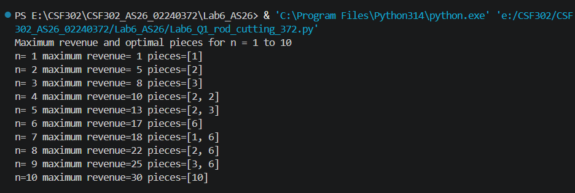
- Figure 1: Q1 maximum revenue and piece lengths for n = 1 to 10.

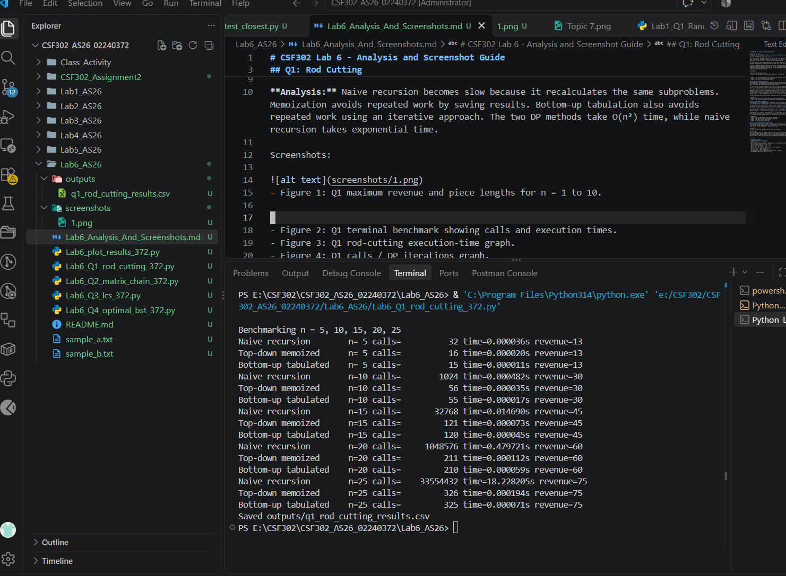
- Figure 2: Q1 terminal benchmark showing calls and execution times.

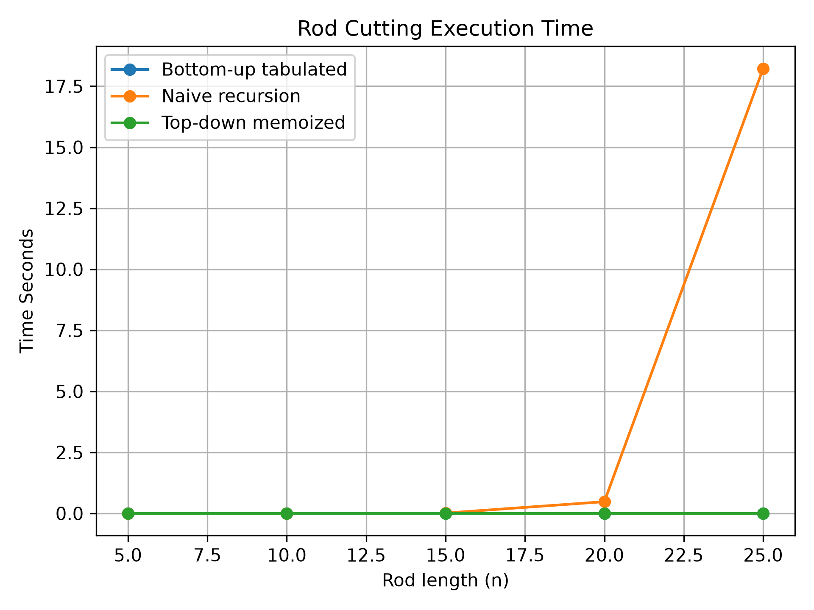
- Figure 3: Q1 rod-cutting execution-time graph.

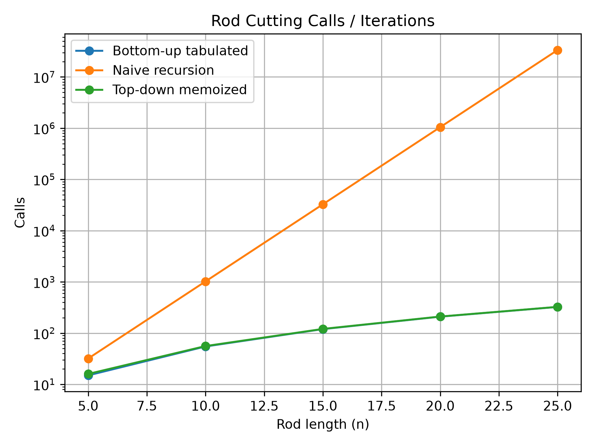
- Figure 4: Q1 calls / DP iterations graph.

## Q2: Matrix Chain Multiplication
The program uses bottom-up dynamic programming to find the minimum number of scalar multiplications. It stores split positions to reconstruct the optimal parenthesisation. It also calculates the left-to-right multiplication cost.

It tests the two required dimension lists and five randomly generated chains. For chains with up to eight matrices, the DP result is checked against brute-force recursive search.

**Analysis:** Matrix-chain multiplication keeps the matrix order the same but changes the parenthesisation. Different parenthesisations can require different numbers of scalar multiplications. Dynamic programming stores the best cost for each subchain, avoiding repeated work. Its time complexity is O(n³), while brute force is exponential.

Screenshots:

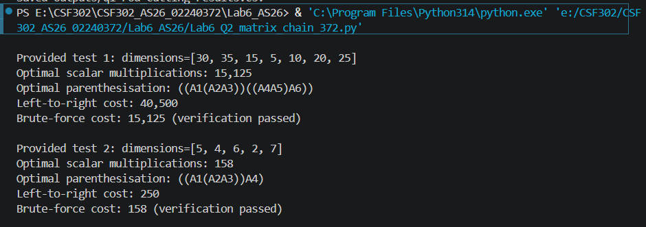
- Figure 5: Q2 first test with optimal cost and parenthesisation.

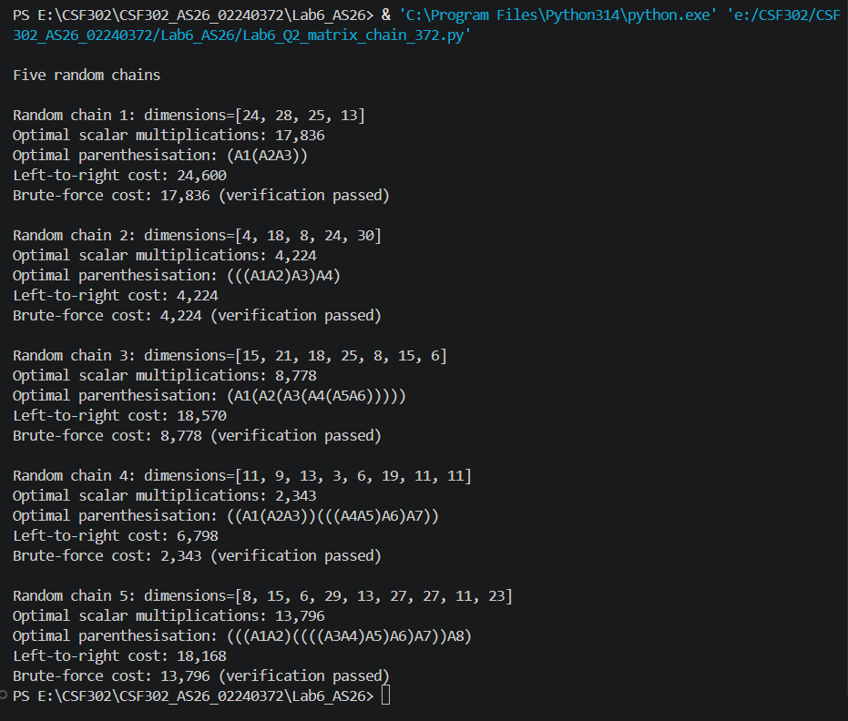
- Figure 6: Q2 second test and five random-chain verification results.

## Q3: Longest Common Subsequence
The program uses X = `ABCBDAB` and Y = `BDCABA`. It prints the DP table, reconstructs one LCS, and calculates the length again using a two-row space-optimised method.

It compares DP with brute force for random strings of lengths 5 to 18. Both methods are checked to return the same length. The timings are saved in `outputs/q3_lcs_timing.csv`.

For the text-file comparison, it reads `sample_a.txt` and `sample_b.txt`. A leading space means unchanged, `-` means removed from file A, and `+` means added in file B.

**Analysis:** Full-table DP takes O(mn) time and O(mn) space. The two-row version keeps O(mn) time but reduces space to O(min(m,n)). Brute force checks all subsequences of X, so its running time grows exponentially. DP is therefore more suitable for longer strings.

Screenshots:

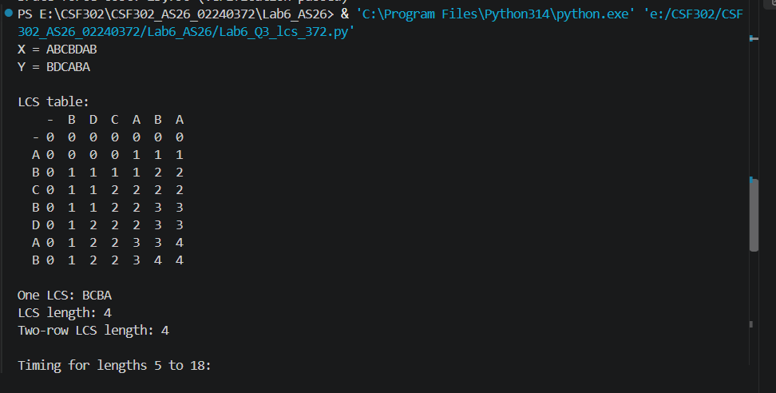
- Figure 7: Q3 LCS table and reconstructed subsequence.

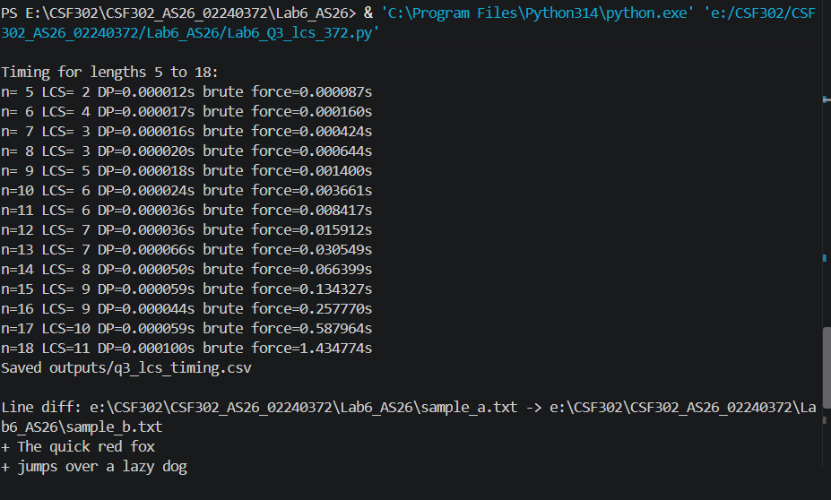
- Figure 8: Q3 two-row result and timing comparison.

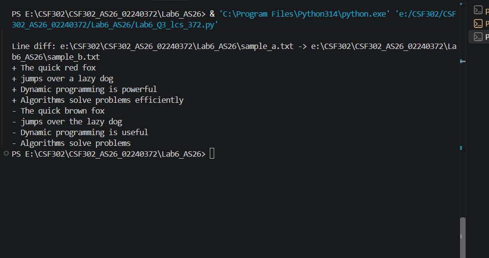
- Figure 9: Q3 line-by-line diff output.

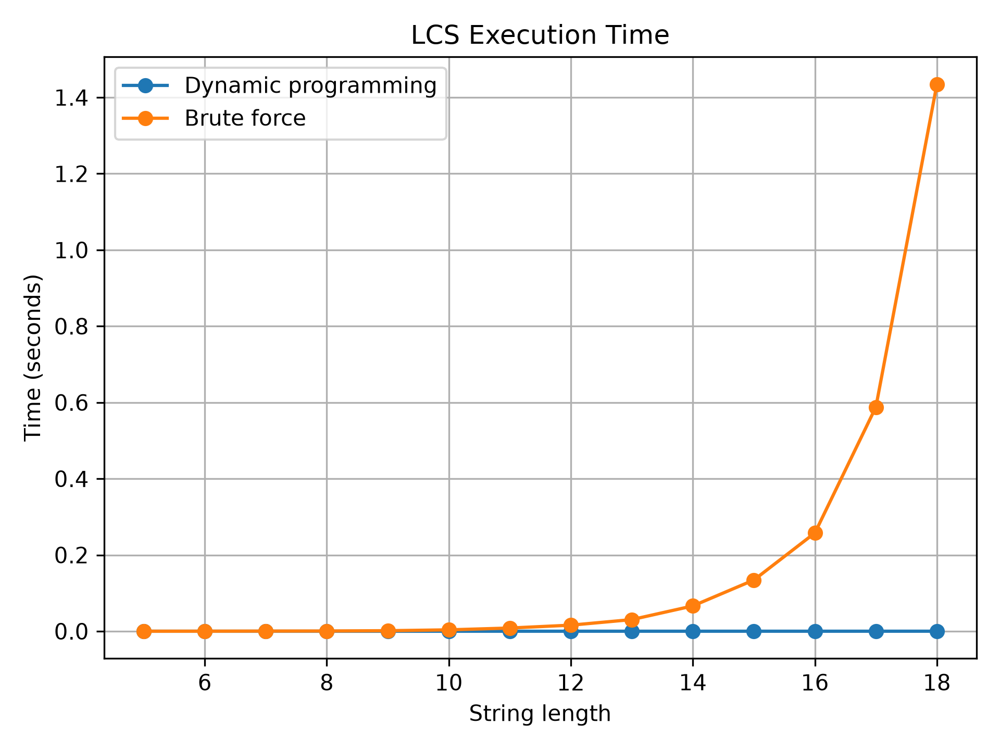
- Figure 10: Q3 execution-time graph.

## Q4: Optional Optimal Binary Search Tree
The optional program uses the given successful-search probabilities p and unsuccessful-search probabilities q. It calculates the expected search cost and prints the tree structure.

Screenshot:

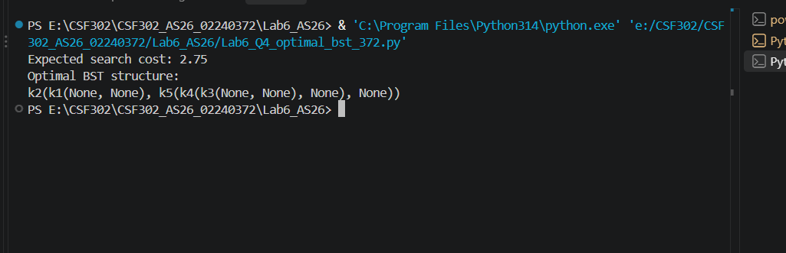
- Figure 11: Optional Q4 expected cost and tree structure.

## Conclusion
This lab demonstrates how dynamic programming stores and reuses results to reduce repeated calculations. Rod cutting compares recursion and DP, matrix-chain multiplication finds an efficient order of multiplication, and LCS finds common sequences and compares text files. Overall, DP is useful when a problem has overlapping subproblems and optimal substructure.

--------

## Complexity summary
| Algorithm | Time | Extra space |
|---|---:|---:|
| Rod cutting - naive recursion | Exponential | O(n) recursion stack |
| Rod cutting - memoized | O(n²) | O(n) |
| Rod cutting - bottom-up | O(n²) | O(n) |
| Matrix-chain DP | O(n³) | O(n²) |
| Matrix-chain brute force | Exponential | O(n) recursion |
| LCS full table | O(mn) | O(mn) |
| LCS two-row DP | O(mn) | O(min(m,n)) |
| LCS brute force over X subsequences | O(2^m * n) | O(m+n) |
| Optimal BST (optional) | O(n³) | O(n²) |