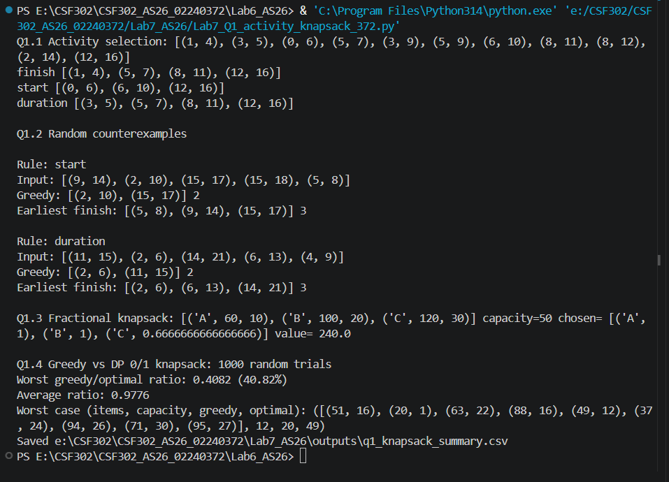
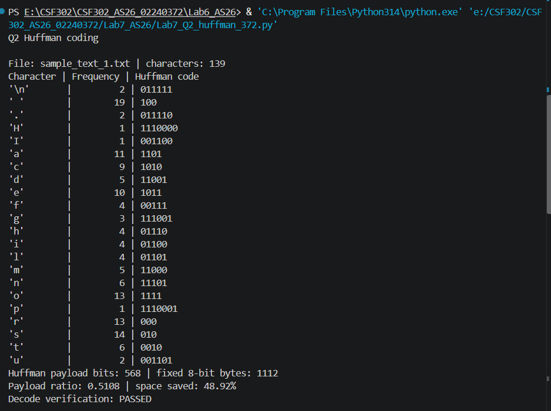
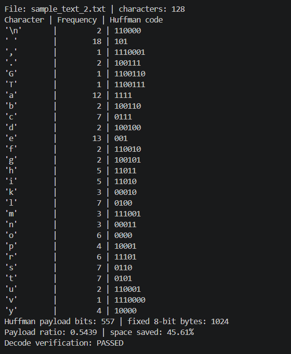
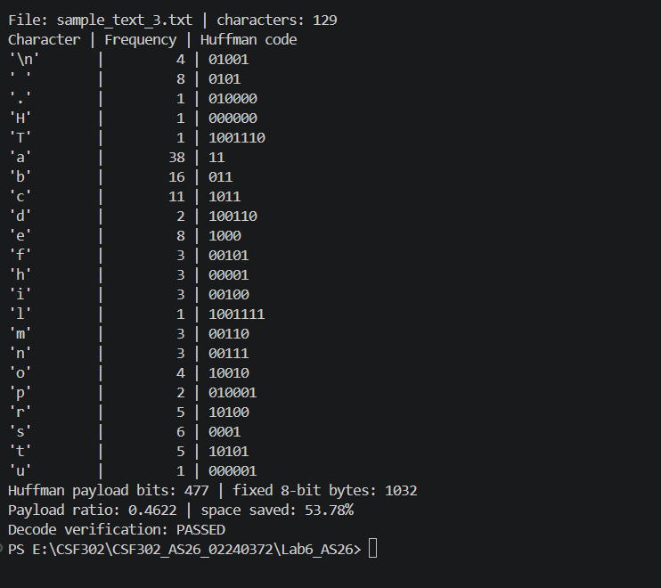
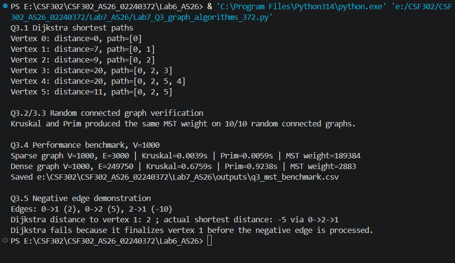
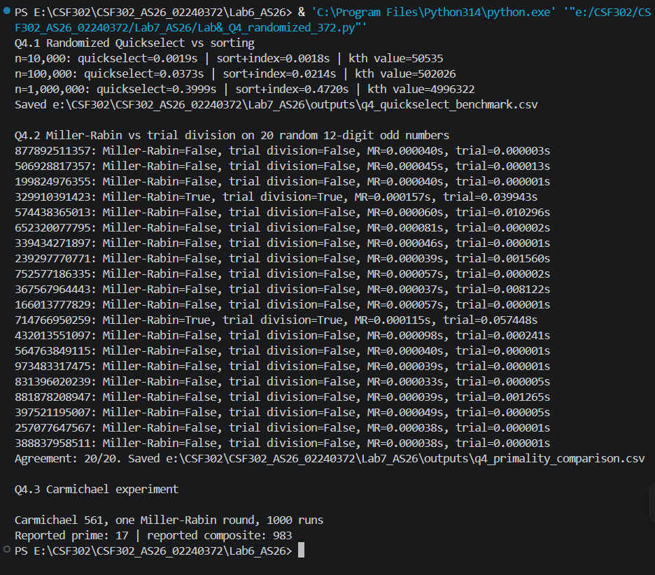

# CSF302 Lab 7 - Analysis and Screenshot Guide

Use the outputs generated on your computer. Timing values may differ between computers.

## Q1: Activity Selection and Knapsack

The activity selection program tests three rules: earliest finish time, earliest start time and shortest duration. Earliest finish is the standard greedy solution because it leaves as much time as possible for the remaining activities. The program searches random inputs for examples where the other two rules select fewer activities.

For fractional knapsack, items are sorted by value-to-weight ratio and fractions of items can be selected. For 0/1 knapsack, items cannot be divided, so the program compares the same ratio-based greedy rule with a dynamic programming solution over 1,000 random cases.

**Analysis:** Earliest finish time gives an optimal activity selection. Earliest start and shortest duration are not always optimal. Ratio-based greedy is optimal for fractional knapsack because items can be divided. It is not guaranteed to be optimal for 0/1 knapsack, so DP can produce a higher value.

Screenshots:

- Figure 1: Q1 activity selection results for all three rules.
- Figure 2: Q1 random counterexamples for earliest start and shortest duration.
- Figure 3: Q1 fractional knapsack selected fractions and maximum value.
- Figure 4: Q1 greedy versus DP 0/1 knapsack worst and average ratios.

## Q2: Huffman Coding

The program counts character frequencies and uses a priority queue to repeatedly combine the two least frequent nodes. It generates a binary code for each character, encodes the text and decodes it to check that the original text is recovered.

Three sample text files are included. For each file, it compares Huffman payload bits with fixed-length 8-bit encoding.

**Analysis:** Huffman coding gives shorter codes to frequent characters and longer codes to less frequent characters. It is lossless because the original text can be recovered. The reported ratio compares payload bits only and does not include storage for the code table.

Screenshots:

- Figure 5: Q2 Huffman code table and encode/decode verification for file 1.
- Figure 6: Q2 results and compression ratios for all three files.

## Q3: Shortest Paths and Minimum Spanning Trees

Dijkstra uses a min-heap to find shortest paths from the source in `directed_graph.txt`. It prints the distance and path to each vertex. Kruskal sorts edges and uses union-find to avoid cycles. Prim grows a tree using a min-heap. The program verifies that both MST algorithms return the same weight on ten random connected graphs.

The performance test uses 1,000 vertices for a sparse graph (about 3V edges) and a dense graph (about V²/4 edges). It also shows a negative-edge example where Dijkstra gives an incorrect result.

**Analysis:** Dijkstra works correctly when all edge weights are non-negative. A negative edge can make a previously finalized distance smaller, breaking its greedy assumption. Kruskal sorts edges and is commonly suitable for sparse graphs. Prim with a heap is also efficient. The measured winner depends on implementation and hardware.

Screenshots:

- Figure 7: Q3 Dijkstra distances and paths.
- Figure 8: Q3 Kruskal and Prim verification on random connected graphs.
- Figure 9: Q3 sparse and dense graph timing comparison.
- Figure 10: Q3 negative-edge example showing Dijkstra's incorrect result.

## Q4: Randomized Algorithms

Randomized Quickselect chooses a random pivot and partitions the list until it finds the k-th smallest value. It is compared with sorting the full list and selecting the same index for 10,000, 100,000 and 1,000,000 values.

Miller-Rabin checks whether a number is probably prime using modular exponentiation and random bases. It is compared with trial division on twenty random 12-digit odd numbers. The program also runs one Miller-Rabin round 1,000 times on Carmichael number 561 and counts how often it reports prime.

**Analysis:** Quickselect has expected linear time, while sorting takes O(n log n). Miller-Rabin is faster than trial division for large numbers because it uses modular exponentiation instead of checking every possible divisor. Multiple rounds make the probabilistic test more reliable. Carmichael numbers can fool Fermat's primality test, but Miller-Rabin can detect many such composites.

Screenshots:

- Figure 11: Q4 Quickselect versus sort-and-index timings.
- Figure 12: Q4 Miller-Rabin and trial-division comparison for 20 numbers.
- Figure 13: Q4 Carmichael number 561 experiment.

## Complexity summary

| Algorithm | Time complexity |
|---|---:|
| Activity selection after sorting | O(n log n) |
| Fractional knapsack | O(n log n) |
| 0/1 knapsack DP | O(nW) |
| Huffman coding | O(n + k log k) |
| Dijkstra with binary heap | O((V + E) log V) |
| Kruskal | O(E log E) |
| Prim with binary heap | O(E log V) |
| Randomized Quickselect | Expected O(n), worst O(n²) |
| Miller-Rabin | O(t log n) modular exponentiation operations |

## Conclusion

This lab helped me understand greedy and randomized algorithms. Greedy methods make choices step by step, while randomized algorithms use random choices to improve expected performance. I also learned how Huffman coding compresses text, how graph algorithms find shortest paths and minimum spanning trees, and why Quickselect and Miller-Rabin are useful for larger inputs.
